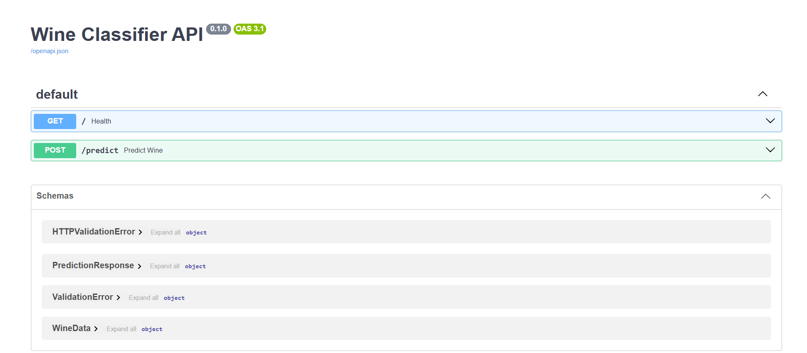
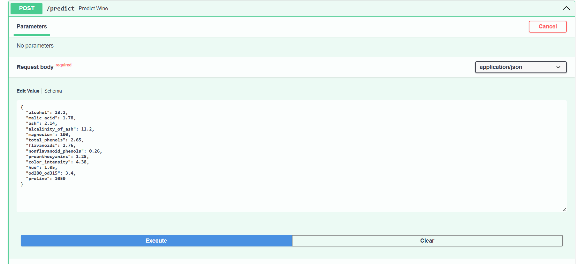
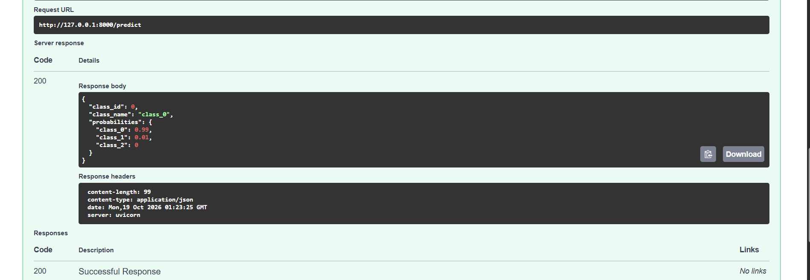
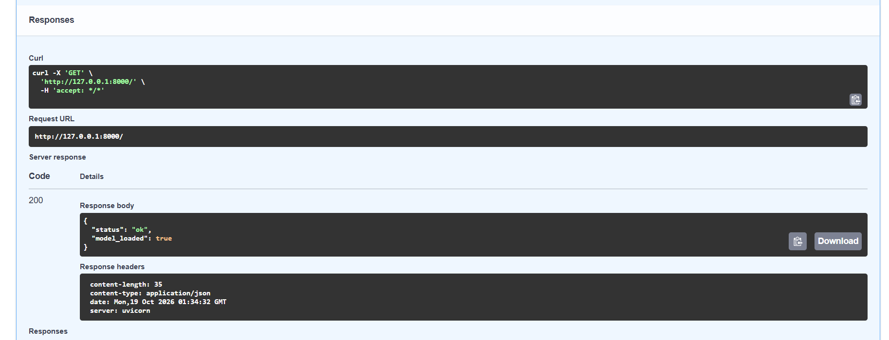

# MLOps Lab: Serving a Model with FastAPI

DADS7305, Northeastern University
Jaiyashree

Trains a Random Forest on the scikit-learn Wine dataset and serves it as a REST API with FastAPI and uvicorn. Based on the FastAPI lab in the course repo, which uses a Decision Tree on Iris.

## Layout

```
src/data.py       loads Wine, 80/20 stratified split
src/train.py      trains the model, saves to model/wine_model.pkl
src/predict.py    loads the model once and returns class + probabilities
src/main.py       FastAPI app and request/response schemas
model/            saved model
assets/           screenshots
requirements.txt
```

## Running locally

```
python -m venv fastapi_lab1_env
fastapi_lab1_env\Scripts\activate
pip install -r requirements.txt
cd src
python train.py
uvicorn main:app --reload
```

Then open http://127.0.0.1:8000/docs. Note the handout says `uvicorn app:main`, which doesn't run. The file is `main` and the instance is `app`.

## Endpoints

`GET /` returns server status and whether the model file exists.

`POST /predict` takes the 13 Wine features and returns the predicted class with per-class probabilities. Requests with missing or non-numeric fields get a 422 from Pydantic validation. If the model hasn't been trained yet, it returns a 503 instead of crashing.

## Results

Test accuracy is 1.0 on the 36-sample test split. Wine is small and well separated, so this says more about the dataset than the model.

## Changes from the lab handout

- Wine (13 features, 3 classes) instead of Iris, Random Forest instead of Decision Tree
- Response includes class probabilities, not just the label
- Model is loaded once and reused instead of on every request
- Added a health check and an HTTPException for the untrained-model case

## Screenshots




